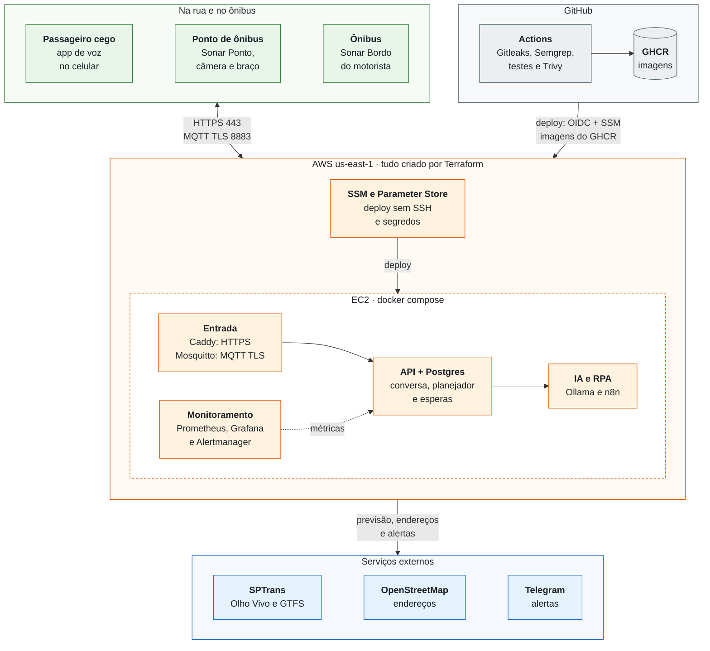

# Sonar

**Pegar o ônibus certo sem depender de um desconhecido.** O Sonar resolve os últimos 20 metros
da viagem de ônibus de uma pessoa cega: saber qual ônibus parou na frente dela e garantir que o
motorista saiba que ela está ali.

- **App de voz (PWA), com um botão só:** a pessoa diz para onde vai ("quero ir para o hospital"), o
  Sonar planeja o caminho (até uma baldeação), avisa o ponto quando ela chega, diz "chegando agora:
  linha 8000-10. É o seu", avisa a hora de descer e, se o ônibus passar direto, registra a
  reclamação quando ela diz "quero reclamar".
- **Sonar Ponto:** o poste do ponto, com a câmera que lê o letreiro. Apita para a pessoa achar o
  poste, pisca uma luz para o motorista e registra cada passagem; sem app ou sem internet, um botão
  no poste avisa os motoristas do mesmo jeito. Nesta versão, o poste é simulado no app e a câmera
  é de verdade (celular ou webcam).
- **Sonar Braço:** cabeça pan-tilt (ESP32 + 2 servos, no simulador Wokwi) que segue o letreiro do
  ônibus chegando, guiada pela câmera e pela IA de visão. É a entrega de Maker Lab:
  [`firmware/`](firmware/README.md).
- **Sonar Bordo:** o bipper na cabine, simulado no app (tela do motorista). Avisa o motorista duas
  paradas antes; ele confirma com um toque e a pessoa ouve "o motorista confirmou".
- **Prova quando o ônibus não para:** com o "sim" do usuário, um robô registra a reclamação com
  as evidências do ponto e devolve o protocolo.

Projeto da Global Solution 2026.2 (CitizenTech), 4º ano de Engenharia de Software da FIAP.

## Ficha técnica

| Integrante | RM |
|---|---|
| Rodrigo Viana | 551057 |
| Caique Chagas | 551943 |
| Gabriel Torres | 98600 |
| Otavio Vitoriano | 552012 |
| Eduardo Fedeli | 550132 |

| Link | |
|---|---|
| App no ar | https://sonar.rodrigoviana.app.br |
| API (OpenAPI) | https://sonar.rodrigoviana.app.br/api/docs |
| Vídeo do Maker Lab | _preencher_ |
| Vídeo de apresentação | _preencher_ |

## Experimente

Abra o app, escolha **Sou passageiro**, toque no botão e diga **"quero ir para o hospital"** (ou
escreva, em "Mais opções").
Na demonstração, a viagem sai da maquete por uma rede de linhas fictícias: o Sonar planeja DEMO-20 +
DEMO-30, você diz "sim", "cheguei", ouve o ônibus errado e o certo, diz "embarquei" e ele avisa a
hora de descer e a baldeação. Para ver um ônibus passando direto, escolha "O ônibus passa direto"
em "Mais opções" e diga "quero reclamar". Abra ao mesmo tempo, em outra aba, o perfil **Sou
motorista** para apertar o "Ciente", ou **Ponto de ônibus** para fazer o papel da câmera e do
botão do poste. Depois do "Ciente", quem diz qual ônibus chegou é a câmera do ponto (o celular, com
`edge/iniciar.ps1 -SemPonto`) ou, sem câmera, a demonstração; se nada chegar, o app lembra o
passageiro do que fazer. Com o GTFS da SPTrans carregado, o mesmo vale para as linhas reais de São Paulo.

## Arquitetura



- **Na rua e no ônibus:** o app de voz fala com a nuvem por HTTPS; o Sonar Ponto, a câmera, o braço
  e o Sonar Bordo, por MQTT com TLS. Todos só abrem conexões de saída: nada na rua tem porta aberta.
- **AWS:** uma EC2 criada por Terraform roda tudo em docker compose, com só as portas 80, 443 e 8883
  abertas; os segredos ficam no Parameter Store.
- **GitHub:** o pipeline barra segredo vazado, código inseguro e imagem vulnerável; na `main`,
  publica as imagens no GHCR e faz o deploy pelo SSM, sem SSH e sem chave da AWS guardada.
- **Serviços externos:** previsão dos ônibus (Olho Vivo e GTFS da SPTrans), endereços
  (OpenStreetMap) e alertas (Telegram).

O que roda dentro da EC2, o caminho do push até o ar e a segurança em camadas estão em
[`docs/arquitetura.md`](docs/arquitetura.md).

## Repositório

```
sonar/
├── app/                    PWA (React + Vite + TypeScript), servido pelo Caddy
├── api/                    API (FastAPI): esperas, SSE, MQTT, Olho Vivo, IA, ocorrências, métricas
├── edge/                   serviço da câmera do ponto (YOLO + OCR; só publica texto)
├── ia/                     agente de GenAI: LLM local (Ollama) + ferramentas que consultam o Olho Vivo
├── rpa/                    RPA: fluxo do n8n que transforma ocorrências em reclamação com protocolo
├── visao/                  treino do YOLO do letreiro (dataset fora do Git)
├── firmware/               Sonar Braço: ESP32 com 2 servos no Wokwi (Maker Lab)
├── infra/terraform/        bootstrap (bucket do state) e nuvem (VPC, EC2, IAM, OIDC, SSM, Budgets)
├── infra/compose/          docker-compose, Caddyfile, Mosquitto e o deploy.sh
├── infra/monitoramento/    Prometheus, alertas no Telegram e Grafana (rodam na EC2)
├── .github/workflows/      ci-cd.yml: Gitleaks, Semgrep, testes, Trivy, GHCR, deploy por SSM, ZAP
└── docs/                   arquitetura, contratos de API e MQTT, LGPD, custo, primeira subida
```

## Rodar na sua máquina

Precisa de Docker com Compose.

```bash
cd infra/compose
cp .env.example .env
docker compose -f docker-compose.yml -f docker-compose.local.yml up --build
```

Abra http://localhost. Sem o token do Olho Vivo, o app funciona no modo demonstração.

Desenvolvimento: `cd api && pip install -r requirements-dev.txt && pytest`;
`cd app && npm ci && npm test && npm run dev` (a API em `localhost:8000`, via
`uvicorn --factory sonar_api.main:create_app`).

## Segurança e DevOps

- **Pipeline** (`.github/workflows/ci-cd.yml`): a cada push, Gitleaks nos commits novos, Semgrep
  (padrão e OWASP Top 10), testes da API, do app (com checagem de acessibilidade pelo axe), da
  câmera e compilação do firmware, `terraform validate` e Trivy na configuração, nas dependências
  e nas imagens, com SBOM. Na `main`: imagens no GHCR, deploy pelo AWS SSM e teste de fumaça em
  `/healthz`, mais um ZAP baseline.
- **Sem segredo no Git:** o deploy gera o `.env` a partir do Parameter Store; o pipeline entra na
  AWS por OIDC, sem chave guardada; a EC2 não tem porta 22.
- **Observabilidade:** a API expõe `/metrics` (tráfego, erros, latência, Olho Vivo, dispositivos);
  o Grafana em `/grafana` mostra os sinais de ouro, e os alertas vão para o Telegram.
- Detalhes: [arquitetura](docs/arquitetura.md), [contratos](docs/contratos.md),
  [LGPD](docs/lgpd.md), [custo](docs/custo.md),
  [responsabilidade compartilhada](docs/responsabilidade-compartilhada.md) e
  [primeira subida](docs/bootstrap.md).
