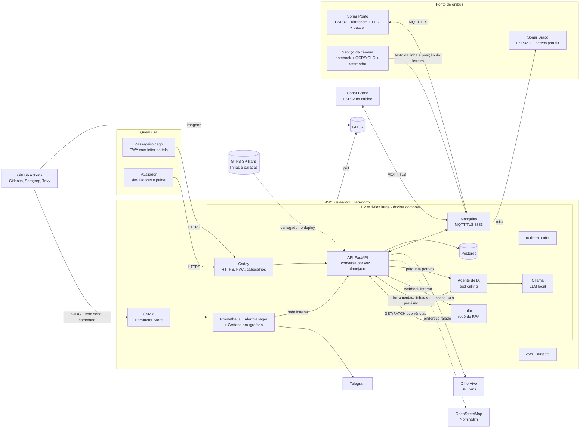

# Arquitetura

**Por que assim.** A EC2 é a única máquina exposta à internet (portas 80, 443 e 8883), e o
monitoramento roda nela, lendo as métricas pela rede interna do compose. O
os ESP32 e o notebook da câmera só fazem conexões de saída, então não precisam de
porta aberta. O pipeline publica sem SSH e sem chave da AWS guardada: troca o token OIDC do
GitHub por credenciais de uma hora, que só podem mandar comando para esta EC2.

**Fluxo de uma viagem.** O app tem um botão só: a pessoa diz o destino (`POST /conversa`), a API
acha o lugar (rede conhecida ou OpenStreetMap), as paradas perto dela e do destino e o melhor
caminho com até uma baldeação (GTFS da SPTrans; na demonstração, uma rede fictícia em volta da
maquete), e fala o plano com a previsão do Olho Vivo. Quando o GPS mostra que a pessoa chegou ao
ponto (ou ela diz "cheguei"), a API abre a espera e publica `ativar` no tópico retido do ponto: o
Sonar Ponto pisca o LED e apita, a API acompanha o Olho Vivo e avisa o Sonar Bordo do ônibus certo
a ~4 minutos, o motorista aperta "ciente", a câmera lê o letreiro (e o braço segue o ônibus), o
Sonar Ponto junta com o ultrassom e publica a passagem, e a API fala "é o seu" pelo SSE. Depois do
"embarquei", o GPS avisa a hora de descer e a baldeação. Se o ônibus passa direto, a pessoa diz
"quero reclamar" e o robô de RPA registra e devolve o protocolo. Sem app, o botão do poste avisa
os motoristas de todas as linhas.

**Como as matérias se encaixam.** IA generativa responde perguntas livres e planeja viagens por
ferramentas (`ia/`), ao lado da conversa por regras que conduz a viagem (`api/sonar_api/conversa.py`); Visão computacional lê o letreiro e acha onde ele está no quadro (`edge/`,
`visao/`); Maker Lab segue o letreiro com o braço e avisa no ponto e na cabine (`firmware/`); RPA
transforma o "não parou" em reclamação com protocolo (`rpa/`); Secure DevOps entrega e vigia tudo
(`infra/`, `.github/`). Cada parte tem uma rede de segurança: sem LLM, a API responde por regras;
sem modelo treinado, a câmera usa só OCR; sem webhook, o robô roda a cada 15 minutos; sem câmera,
o Sonar Ponto decide pelo ultrassom e avisa "sem confirmação visual".

**Segurança em camadas.**

| Camada | Controle |
|---|---|
| Borda | só 80/443/8883; HTTPS automático; HSTS, CSP restritiva, Permissions-Policy |
| Aplicação | validação de entrada (Pydantic), limite de requisições, token só para o robô, métricas só na rede interna, Grafana com login |
| Dispositivos | usuário e senha por dispositivo, ACL por tópico, TLS com as raízes da Let's Encrypt fixadas no firmware |
| Containers | sem root, `no-new-privileges`, `cap_drop: ALL`, sistema de arquivos só leitura, limite de memória |
| Nuvem | IMDSv2 com hop limit 1 (containers não pegam a credencial da EC2), disco cifrado, papéis IAM mínimos, segredos no Parameter Store |
| Pipeline | Gitleaks, Semgrep, Trivy (IaC, dependências e imagens), SBOM, ações fixadas em versões que rodam no Node 24, Dependabot |
