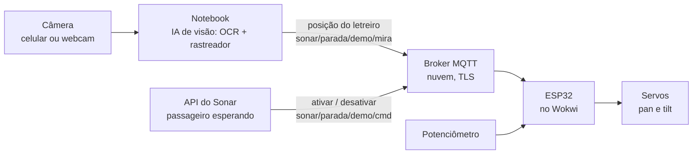

# Sonar Braço · Maker Lab

**Global Solution 2026.2 · CitizenTech · FIAP, Engenharia de Software**

▶ **Vídeo da demonstração:** https://youtu.be/ANpH-VH-BQk

| Integrante | RM |
|---|---|
| Rodrigo Viana | 551057 |
| Caique Chagas | 551943 |
| Gabriel Torres | 98600 |
| Otavio Vitoriano | 552012 |
| Eduardo Fedeli | 550132 |

## O problema

No ponto de ônibus, uma pessoa cega não consegue ler o letreiro do ônibus que está chegando. Ela
depende de perguntar a um desconhecido ou de o motorista parar e avisar. É uma barreira de
mobilidade urbana, o tema do CitizenTech: a cidade tem a informação (o letreiro), mas ela não chega a
quem não enxerga.

## A solução

O **Sonar Braço** é o robô do [Sonar](../README.md), o sistema que avisa a pessoa cega qual ônibus
chegou. É uma cabeça pan-tilt, um ESP32 com dois servos, que **segue o letreiro do ônibus** que se
aproxima:

- uma câmera (o celular, com o app DroidCam, ou uma webcam) filma a rua;
- no notebook do ponto, a IA de visão computacional acha e lê o letreiro e calcula onde ele está na imagem;
- a posição vai pela nuvem (MQTT com TLS) até o ESP32, que gira os servos e aponta para o ônibus;
- enquanto um passageiro espera e nenhum ônibus aparece, o braço varre a rua de um lado para o outro.

O ESP32 roda no simulador [Wokwi](https://wokwi.com), ligado de verdade à internet: a câmera, a IA e a
nuvem são reais; só a placa e os servos são simulados.



## Componentes

| Componente | Onde | Para que serve |
|---|---|---|
| ESP32 DevKit C v4 | Wokwi | controla os servos e conversa com a nuvem (Wi-Fi e MQTT com TLS) |
| Servo pan, no GPIO 18 | Wokwi | gira a cabeça para os lados, de 20° a 160° |
| Servo tilt, no GPIO 19 | Wokwi | inclina a cabeça, de 60° a 120° |
| Potenciômetro, no GPIO 34 | Wokwi | modo manual: girar o botão move o braço por 10 s |
| Câmera: celular com DroidCam, ou webcam | notebook | o sensor que vê a rua |
| Serviço da câmera ([`edge/`](../edge/README.md)) | notebook | a IA de visão: acha, lê e segue o letreiro |
| Broker MQTT (Mosquitto, porta 8883) | nuvem (AWS) | leva a posição até o braço, com senha e permissão por dispositivo |
| Letreiros impressos ([`visao/imprimir.py`](../visao/imprimir.py)) | mesa | os "ônibus" DEMO-10 e DEMO-20 |

As ligações estão no [`diagram.json`](diagram.json): os dois servos no 5V e no GND do ESP32, com o
sinal nos GPIO 18 e 19, e o potenciômetro no 3V3 e no GND, com o cursor no GPIO 34.

## Integração da câmera com a IA e com o braço

1. **A câmera filma.** O serviço da câmera lê o vídeo do celular (pelo Wi-Fi) ou da webcam.
2. **A IA acha e lê o letreiro.** O OCR (EasyOCR) lê os textos da imagem, cerca de uma vez por
   segundo. Se existir o modelo YOLO treinado em [`visao/`](../visao/README.md), ele acha o letreiro
   primeiro e o OCR lê só esse recorte. O texto é comparado com as linhas que passam no ponto
   (DEMO-10 e DEMO-20), corrigindo as trocas comuns do OCR, como O por 0 e I por 1.
3. **Um rastreador segue o letreiro entre uma leitura e outra.** O OpenCV acompanha o letreiro em
   milissegundos, então a posição sai até 7 vezes por segundo, mesmo com o OCR levando 1 s.
4. **Só a posição sai do notebook**, nunca a imagem. Ela vai para o tópico `sonar/parada/demo/mira`:
   ```json
   {"alvo": true, "x": 0.42, "y": 0.5, "linha": "DEMO-10"}
   ```
   `x` e `y` são o centro do letreiro na imagem, de 0 a 1. Quando o letreiro some por 1 s, vai
   `{"alvo": false}`.
5. **O ESP32 aponta.** Ele converte a posição em ângulo (letreiro à esquerda, `x` = 0: pan em 160°;
   à direita, `x` = 1: pan em 20°; a altura vira o tilt) e anda no máximo 3° a cada 20 ms, para o
   movimento sair suave.

O braço também recebe os comandos da API do Sonar em `sonar/parada/demo/cmd`: `ativar` quando um
passageiro diz "cheguei" no app (o braço começa a procurar o ônibus) e `desativar` quando a espera
termina. Ele publica o próprio estado em `sonar/parada/demo/braco/status`.

```
REPOUSO ──"ativar" (passageiro esperando)──▶ PROCURANDO (varre de 20° a 160°)
REPOUSO ou PROCURANDO ──chegou a posição do letreiro──▶ SEGUINDO
SEGUINDO ──"alvo: false" ou 3 s sem posição──▶ PROCURANDO (com espera) ou REPOUSO
qualquer um ──girou o potenciômetro──▶ MANUAL por 10 s
```

**Segurança:** a conexão usa TLS e o sketch confere o certificado do broker. Cada dispositivo tem
usuário e senha próprios, e o broker só deixa o braço ler `mira` e `cmd` e escrever o próprio estado.
Como projeto gratuito no Wokwi é público, a senha não está no código: ela é colada no Serial Monitor
quando a simulação começa.

**Por que assim:** um ESP32 não roda OCR nem YOLO, então a visão fica no notebook e o ESP32 recebe só
dois números. O MQTT é leve, funciona bem no ESP32 e guarda o último comando para quem conectar
depois. No simulador, a câmera não fica presa na cabeça do braço: o servo aponta direto para a
posição do letreiro (malha aberta).

## Como executar

Você vai precisar de:

- um navegador, para o Wokwi;
- um notebook com Windows e Python 3.11 ou mais novo;
- uma câmera: um celular com o app DroidCam, na mesma rede Wi-Fi do notebook, ou uma webcam;
- as senhas MQTT do braço (`braco-demo`) e da câmera (`camera-demo`). Elas ficam no Parameter Store
  da AWS do projeto:
  `aws ssm get-parameter --name /sonar/mqtt/usuarios/braco-demo --with-decryption --query Parameter.Value --output text`
  (e o mesmo com `camera-demo`).

### 1. Ligue o braço no Wokwi

1. Em [wokwi.com](https://wokwi.com), clique em **New Project** e escolha **ESP32**.
2. Cole o [`sketch.ino`](sketch.ino) no `sketch.ino` e o [`diagram.json`](diagram.json) no `diagram.json`.
3. Crie o arquivo `libraries.txt` (botão **+**, depois **New file**) e cole o [`libraries.txt`](libraries.txt).
4. Clique em **Play**. Quando o Serial Monitor pedir, cole a senha do `braco-demo` e tecle Enter.
5. Espere `[rede] MQTT conectado: esperando a posição do letreiro`. No simulador, a conexão segura
   leva uns 30 s.

### 2. Ligue a câmera e a IA no notebook

1. No celular, abra o DroidCam: ele mostra o IP. Confira no navegador do notebook:
   `http://IP_DO_CELULAR:4747/video`.
2. No PowerShell, na pasta do repositório:
   ```powershell
   cd edge
   .\iniciar.ps1 -Braco -Camera "http://IP_DO_CELULAR:4747/video"
   ```
   Com a webcam do notebook, basta `.\iniciar.ps1 -Braco`. Na primeira vez, o script instala tudo
   (alguns minutos). Ele pede a senha do `camera-demo`. O `-Braco` faz a câmera procurar o letreiro o
   tempo todo, mesmo sem passageiro esperando.
3. Abre uma janela com a imagem: os textos lidos aparecem em laranja e o letreiro seguido, em verde.

### 3. Teste

1. Imprima os letreiros: `python visao/imprimir.py`.
2. Mostre o DEMO-10 para a câmera e mova o papel para os lados e para cima e para baixo: o servo pan
   acompanha o lado e o tilt acompanha a altura. O terminal mostra
   `mira: seguindo DEMO-10; a posição está indo para o braço`, e o Wokwi, `[braco] repouso -> seguindo`.
3. Tire o letreiro da frente da câmera: depois de 1 s o braço volta ao centro (ou volta a procurar,
   se há passageiro esperando).
4. Gire o potenciômetro no Wokwi: o servo pan segue o botão por 10 s (modo manual).
5. Sem câmera: `.\iniciar.ps1 -Modo teclado -Braco` e digite `DEMO-10@0.1` (letreiro à esquerda) ou
   `DEMO-10@0.9` (à direita).
6. Com o app do Sonar (https://sonar.rodrigoviana.app.br): diga "quero ir para o terminal", "sim" e
   "cheguei". O braço começa a varrer a rua procurando o ônibus.

Para usar outro broker MQTT, troque `MQTT_HOST`, `MQTT_PORTA` e `MQTT_USUARIO` no início do
`sketch.ino` e rode a câmera com `-Servidor <endereço>`.

## Arquivos desta pasta

| Arquivo | O que é |
|---|---|
| [`sketch.ino`](sketch.ino) | o firmware do ESP32, em um arquivo só, pronto para o Wokwi |
| [`diagram.json`](diagram.json) | o circuito: o ESP32, os dois servos e o potenciômetro |
| [`libraries.txt`](libraries.txt) | as bibliotecas que o Wokwi instala: ArduinoJson, ESP32Servo e PubSubClient |

O serviço da câmera e a IA ficam em [`edge/`](../edge/README.md), e o treino do YOLO, em
[`visao/`](../visao/README.md). A cada push, o CI do repositório compila este `sketch.ino` para um
ESP32 de verdade, com o PlatformIO.
